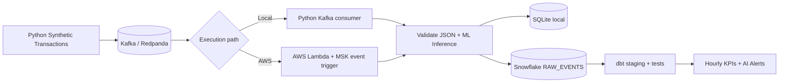

# Real-Time AI Event Processing Pipeline

**Python · Kafka/Redpanda · AWS Lambda · Isolation Forest ML · Optional Generative AI · Snowflake · dbt · GitHub Actions**

An end-to-end **portfolio-grade data engineering project** that processes **synthetic transaction events** through Kafka, enriches each event with an AI/ML anomaly signal, stores the results, and builds analytics-ready marts in Snowflake/dbt. Includes an **offline one-command demo** (no cloud account required), a live local Kafka pathway, unit tests, CI and a starting-point AWS Lambda deployment.

> **Status:** Local Python demo and automated unit tests are executable without cloud services. Cloud deployment is optional and needs real AWS/Snowflake credentials and infrastructure. "Real-time" describes event ingestion/inference; dbt models are refreshed on demand or an external schedule. No production latency or throughput SLA is claimed.

## What it does

- **Streams JSON events:** Python simulation creates reproducible, fake retail transactions, including an evaluation-only simulated-anomaly flag.
- **Detects unusual transactions using actual ML:** a trained scikit-learn **Isolation Forest** scores category-normalized amounts, time of day, channel and country features.
- **Adds explainable signals:** transparent reason codes (e.g. `unusually_high_amount`) accompany the model's anomaly prediction and a *non-probabilistic* risk ranking.
- **Processes with Kafka:** a local Python consumer uses offset commits after persistence; an AWS Lambda handler decodes Kafka event-source mapping batches.
- **Persists replay-safely:** SQLite local demo or Snowflake cloud sink, both keyed by unique event IDs.
- **Transforms with dbt:** staging model, hourly transaction KPI mart and anomaly alert mart, with basic data tests.
- **Adds optional GenAI summaries:** an OpenAI Responses API adapter converts anonymized, synthetic alerts into an operational narrative (off by default; API key and billing required).
- **Automates validation:** pytest suite and GitHub Actions CI running an offline end-to-end smoke test.

## Architecture



Local Python **demo** uses the same validator, model and processor but bypasses Kafka so anyone can run it without Docker. Local Kafka and AWS Lambda are separate execution paths, not serial stages: **Kafka → either local consumer or Lambda → AI scoring → sink → dbt**.

**Brand new to GitHub or VS Code?** Start with **[START_HERE.md](START_HERE.md)** for five beginner steps. A locally verified sample run is recorded in [demo results](docs/DEMO_RESULTS.md).

## Quick start: run without Docker, AWS or Snowflake

Requirements: Python 3.10 or newer, terminal (PowerShell, VS Code, or bash).

```bash
# Extract/download this repository and open its directory
cd real-time-ai-event-pipeline

# Create environment (Windows PowerShell: .venv\Scripts\Activate.ps1)
python -m venv .venv
# macOS/Linux:
source .venv/bin/activate

# Install this project
python -m pip install -e '.[dev]'

# Generate transactions, train the ML model if needed, and persist AI results
python -m event_pipeline.cli demo --count 150

# Show local reporting metrics / AI alerts
python -m event_pipeline.cli report
python -m event_pipeline.cli ai-summary  # Free, deterministic summary
python -m event_pipeline.cli evaluate    # Precision/recall on synthetic holdout data

# Execute tests
python -m pytest -q
```

Generated outputs are kept out of Git by `.gitignore`:

| Path | Purpose |
|---|---|
| `models/anomaly_detector.joblib` | Reproducible model trained on synthetic normal events |
| `data/events.sqlite` | Offline data warehouse for local experimentation |
| `data/alerts.csv` | Export of events classified as anomalous |

**Expected behavior:** Console prints event totals, AI alert counts, total simulated amount, and top alerts. Counts depend on inputs/model. The **first run** will train the model automatically; later runs reuse it. Run `train-model` explicitly to retrain.

**Windows PowerShell alternative to `source`:** `.\.venv\Scripts\Activate.ps1`. If execution policy blocks activation, invoke `.\.venv\Scripts\python.exe` directly for the `-m pip`, `-m event_pipeline.cli`, and `-m pytest` commands.

## Local live event streaming with Kafka

Requirements: Docker Desktop running. Docker Compose launches **Redpanda**, a Kafka API-compatible local broker, bound to loopback only (not internet-exposed).

```bash
python -m pip install -e '.[kafka,dev]'
docker compose up -d
```

Open **Terminal A** and start the consumer:

```bash
python -m event_pipeline.cli consume --sink sqlite --max-events 100
```

Open **Terminal B** and publish exactly 100 fake events:

```bash
python -m event_pipeline.cli produce --count 100 --seed 42
```

Inspect persisted results:

```bash
python -m event_pipeline.cli report
# Stop the broker when done
docker compose down
```

The producer creates the topic if missing. Consumer group offsets persist; if you want to replay events, use a fresh `KAFKA_GROUP_ID` in `.env` or reset offsets. Even on replay, the sink ignores duplicate IDs. **Do not** interpret local Redpanda as deployed AWS MSK.

## Optional generative AI alert brief (LLM)

The project already performs **genuine AI/ML inference** using Isolation Forest. For an additional GenAI use case, you can ask an LLM to explain the most interesting synthetic anomalies. The LLM runs **only when you request `--llm`**; it never runs in the event-ingestion hot path. Only aggregate statistics and synthetic amount/country/reason fields are sent, not event IDs or users.

```bash
python -m pip install -e '.[llm]'
# Set the OPENAI_API_KEY environment variable privately on your machine.
python -m event_pipeline.cli ai-summary --llm
```

The example uses the OpenAI Responses API and the `OPENAI_MODEL` variable (default `gpt-4.1-mini`). **This may incur usage charges and needs an active API account**; it was tested with a mock client but not with a live API in this environment. Without the flag, `ai-summary` produces a free deterministic report. The LLM's narrative is descriptive; it does not classify events or claim fraud.

## Snowflake and dbt (optional)

1. Provision a Snowflake account and an auto-suspend compute warehouse.
2. Apply [`sql/setup.sql`](sql/setup.sql) in a SQL worksheet.
3. Copy `.env.example` to `.env` and fill in your own Snowflake settings; never commit the resulting file.
4. Install `python -m pip install -e '.[kafka,snowflake]'`; set `SINK=snowflake` and run the local consumer against Kafka. **This writes real rows to Snowflake.**
5. Install `python -m pip install 'dbt-snowflake>=1.8,<3'`; configure dbt using [`dbt/profiles.yml.example`](dbt/profiles.yml.example) and export your `SNOWFLAKE_*` variables, then run:

```bash
cd dbt
dbt debug
dbt run
dbt test
```

| dbt model | Output |
|---|---|
| `stg_events` | Latest record for each event ID, typed raw fields |
| `fct_hourly_events` | Hourly count, active users, total/average amount, AI anomaly rate by category |
| `fct_anomaly_alerts` | Filtered high-signal event details for investigation |

Run `dbt run` at a scheduled cadence for regularly refreshed marts. A scheduler is **not** bundled into the example.

## AWS Lambda (optional)

The Lambda handler parses base64 Kafka batches from AWS MSK or compatible self-managed Kafka mappings. The included `aws/template.yaml` and `Dockerfile.lambda` demonstrate an **MSK-based** image deployment; the AWS resources must already exist and can incur charges. See **[Deployment guide](docs/DEPLOYMENT_AWS.md)** for secrets management, networking, costs, SAM CLI and dbt.

## Sample event

```json
{
  "event_id": "8d95f9de-a613-4c2f-8e12-86201e38704d",
  "event_time": "2026-10-25T12:00:00+00:00",
  "user_id": "user_0018",
  "merchant_category": "electronics",
  "amount": 120.50,
  "country": "US",
  "channel": "mobile",
  "device_id": "dev_0042",
  "is_simulated_anomaly": false,
  "schema_version": 1
}
```

This sample is illustrative; the producer generates its own IDs and timestamps. No real personal or payment data is collected.

## Project layout

```text
real-time-ai-event-pipeline/
├── src/event_pipeline/
│   ├── ai.py              # Trained unsupervised anomaly detection
│   ├── genai.py           # Optional LLM narrative for synthetic alerts
│   ├── evaluation.py      # Holdout synthetic-label precision/recall evaluation
│   ├── events.py          # Validated transaction event contract
│   ├── simulation.py      # Deterministic fake-event generator
│   ├── kafka_io.py        # Kafka producer + consumer
│   ├── processor.py       # Shared ML enrichment path
│   ├── sinks.py           # SQLite / Snowflake idempotent writes
│   ├── lambda_handler.py  # AWS Kafka batch decoding
│   ├── config.py          # Environment configuration
│   └── cli.py             # Commands: demo, produce, consume, report
├── tests/                 # Unit and Lambda-adapter tests
├── sql/setup.sql          # Raw Snowflake table and schemas
├── dbt/models/            # Staging and analytics marts
├── aws/template.yaml      # Example MSK + Lambda SAM stack
├── docs/                  # Architecture, cloud setup, interview & GitHub guides
├── .github/workflows/     # CI tests + offline demo
├── docker-compose.yml     # Local Redpanda Kafka broker
├── Dockerfile.lambda      # Containerized Lambda model runtime
├── pyproject.toml         # Python dependencies and CLI entry point
└── .env.example           # Secret-free config example
```

## Quality and limitations

- **Tests:** validation, model serialization, anomaly reason codes, database duplicate suppression, Lambda event decoding and local end-to-end processing.
- **Security:** all events are synthetic; no API tokens or passwords are stored in Git. The local broker uses no auth and is only bound to 127.0.0.1.
- **Model:** trained only on simulated data; no independent real-world performance claims or calibrated fraud probability. Reason codes are heuristic rules.
- **Exactly-once:** writes are idempotent by event ID for ordinary retries, but no distributed exactly-once protocol. Snowflake standard-table primary key constraints are informational.
- **Scale:** Snowflake uses a per-event MERGE for educational readability; batch/Snowpipe-based ingestion is the next step for a high-volume workload.
- **Near-real-time:** Kafka/Lambda streaming path is event driven; dbt models are refreshed when a run is triggered, not in real time by themselves.

## Publish it on GitHub

No GitHub account yet? See **[the beginner-friendly GitHub setup guide](docs/GITHUB_SETUP.md)** for signup, account security, creating a repository, first push, and pinning it to your profile. To prepare for technical interviews, use **[the interview guide](docs/INTERVIEW_GUIDE.md)**.

## Official documentation

- [AWS Lambda Kafka event sources](https://docs.aws.amazon.com/lambda/latest/dg/with-kafka.html)
- [Snowflake Python connector](https://docs.snowflake.com/en/developer-guide/python-connector/python-connector-example)
- [dbt documentation](https://docs.getdbt.com/)
- [GitHub new repositories](https://docs.github.com/en/repositories/creating-and-managing-repositories/creating-a-new-repository)

## License

MIT. Created as an educational, GitHub-ready portfolio starter; cloud integrations require your own deployment and verification.
