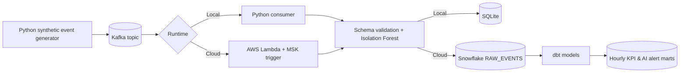

# Architecture and event lifecycle

## Lifecycle

1. Producer emits JSON events with UUID, UTC event time, synthetic user ID, merchant type, amount, geography, device, and an evaluation-only simulated anomaly label.
2. Kafka persists events (local Docker uses Redpanda, a Kafka-protocol-compatible broker).
3. Local consumer or Lambda decodes Kafka messages and validates fields.
4. Isolation Forest scores incoming events; a separate rule-based component creates understandable reason codes.
5. Sink writes event payload plus model results. Event ID is used for deduplication.
6. In Snowflake, dbt runs staging and mart SQL to produce hourly event KPIs and flagged-event details.

## Idempotency and operational behavior

- The local consumer commits a Kafka offset after a successful SQLite/Snowflake write.
- Lambda receives a batch and throws on any decode/inference/write error. The service retries batches; previously written IDs are skipped by the sink.
- Invalid Kafka messages stop a local consumer and will retry in Lambda. A dead-letter strategy is a documented future enhancement, not implemented here.
- Per-event Snowflake MERGE is for clarity at portfolio scale; batch staging/COPY+MERGE would be better under load.
- dbt transformations are snapshots at the time of a dbt run, not a continuously running stream processor.
- Snowflake standard-table primary key metadata is not enforced; separate concurrent writers need stronger coordination for race-free deduplication.

## AI modeling caveats

Isolation Forest is an **unsupervised ML** method, not a large language model. The project satisfies an AI/ML use case via actual trained model inference. The training events and ground-truth labels are synthetic. The model is educational and not appropriate for financial fraud decisions. Reason codes come from transparent rules, not from model feature attribution. Model artifacts serialized with joblib must only be loaded from trusted project-created locations.
